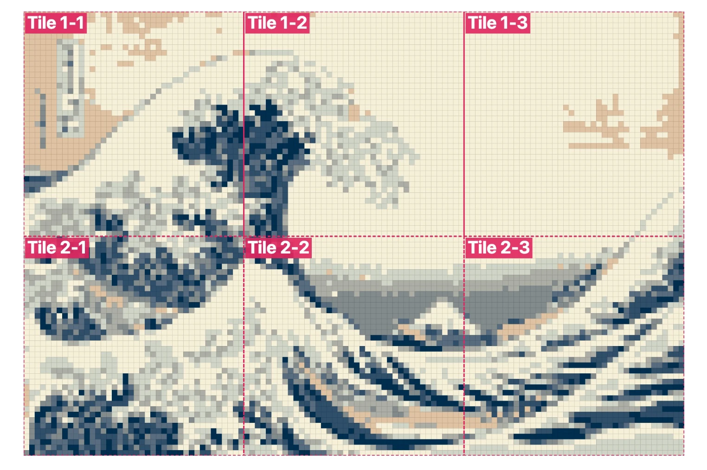

# Sticker Mosaic Maker

Turn any picture into a giant collaborative sticker mosaic, similar to the [StickTogether Poster](https://www.demco.com/products/learning-materials-resources/explore/sticktogether). The app prints a poster grid where every square has a letter, and cuts matching vinyl squares where each letter is one color. Peel, match the letter, stick, and the picture appears.

It's built for a school or library makerspace with a large-format poster printer and a Roland vinyl cutter. The poster can be tiled across many prints to make a wall-sized mosaic.

## Example

Hokusai's *The Great Wave off Kanagawa* as a 60″ × 40½″ mosaic: 120 × 81 half-inch squares, 8 colors and 9,720 stickers, printed as 6 tiles (3 across × 2 down) on a 24″ poster printer. The dashed lines show where the poster is split into tiles.

Sample output: [color key and assembly map (PDF)](examples/great-wave-color-key.pdf). It shows the tile layout and assembly steps, a color key with the sticker count, sheet count and vinyl length for each color, and a vinyl shopping list with the closest ORACAL 651 color and roll size to order.

## Getting started

1. Download `mosaic-maker.html` (or clone this repo).
2. Open it in a current Chrome, Edge, Firefox or Safari. No install or server is needed.
3. Add a picture and work through the numbered steps on the left.

The PDF and ZIP downloads load two small libraries ([jsPDF](https://github.com/parallax/jsPDF) and [JSZip](https://github.com/Stuk/jszip)) from cdnjs, so those buttons need an internet connection. Everything else works offline. Your picture never leaves your computer.

## How it works

| Step | What you do |
|---|---|
| **1. Picture** | Drop in, choose or paste an image, and give the mosaic a title. |
| **2. Finished size** | Set width and height in inches and the square size (½″ by default, like commercial sticker-mosaic kits). Quick buttons show the sticker count at other square sizes. |
| **3. Colors** | Pick colors from the picture, or only from vinyl you stock. Choose how many, then fine-tune. |
| **4. Poster printing** | Set printer paper width (24″ by default) and maximum tile length. The grid is split into tiles that break on whole squares. |
| **5. Vinyl cutting** | Set roll width, sheet length, sticker size and extra stickers, then download cut files. |
| **6. Buy vinyl** | See the closest ORACAL 651 color for each sticker color, how much to order, and store search links. |
| **7. Time estimate** | Estimated human-hours to weed, place and mount, for one person or shared by a group. |

The preview on the right shows the finished mosaic, the lettered poster, the original, or the original and mosaic side by side. A **Likeness** score shows how closely the mosaic's colors match the original from a few steps back.

## Getting a recognizable picture with few colors

Step 3 includes controls for getting the most out of a limited palette:

- **Color priority (big areas ↔ small details):** keeps large flat areas like sky from using up every color, so faces, eyes and lettering get their own.
- **Sharpen details:** sharpens the square grid before colors are chosen, so features don't blur together.
- **Contrast and saturation:** adjust the picture before colors are chosen.
- **Blend gradients:** adjustable dithering for smooth skies and skin tones.
- **Clean up stray single squares:** removes lone, out-of-place squares without erasing real highlights.

Color matching gives lightness extra weight, because light-versus-dark structure matters most for recognizing a picture.

Rough starting points: for photos of people, use 8–12 colors with priority toward small details. For logos, cartoons and posters, set priority toward big areas and turn sharpening down.

## What you get

**Poster tiles (PDF).** One page per tile, at actual size. Each tile has crop marks, its name (row-column, e.g. `1-2`), its grid range, its neighbors and a small map of where it goes. Print at 100% with no scaling, trim on the outer grid line, and butt the tiles together.

**Color key and map (PDF).** A letter-size guide with the finished mosaic and tile layout, assembly steps, a color key with sticker counts and vinyl lengths, and a vinyl shopping list.

**Vinyl cut files (ZIP).** One SVG and one EPS per vinyl sheet, named by color letter, plus `cut-list.csv` and `shopping-list.csv`. Files are drawn at actual size in inches. Choose one of two layouts:

- **Shared grid lines:** faster to cut, and you only weed the border.
- **Separate squares with gaps.**

Import whichever format your Roland software (CutStudio or VersaWorks) accepts, and kiss-cut through the vinyl but not the backing.

**Shopping list (CSV)** and a **preview PNG** are also available.

## Buying vinyl

The vinyl list is ORACAL 651, using the color values ORAFOL publishes for each color. For every sticker color, the app shows:

- the closest 651 color, rated Exact match, Very close, Close, or No close 651 color
- whether a matte version exists
- how much to order, including 10% for test cuts
- a suggested roll size: 12″ × 10 ft craft rolls, or 10-yard and 50-yard sign-supply rolls
- search links to several stores (you can add your own vendor)

Screen colors are approximate. Order a printed ORACAL 651 color chart and check it against your picture before buying. For purchase orders or bulk rolls, order through an authorized ORAFOL sign-supply distributor.

## Notes

- Your vinyl stock list and store list are saved in your browser only. They don't travel with the file.
- The time estimate defaults to 8 seconds to place each sticker, 1 second to weed each sticker, and 10 minutes to trim and mount each tile. Adjust these to match your group.
- Before a big job, print one tile and cut one sheet to check scale and fit.
